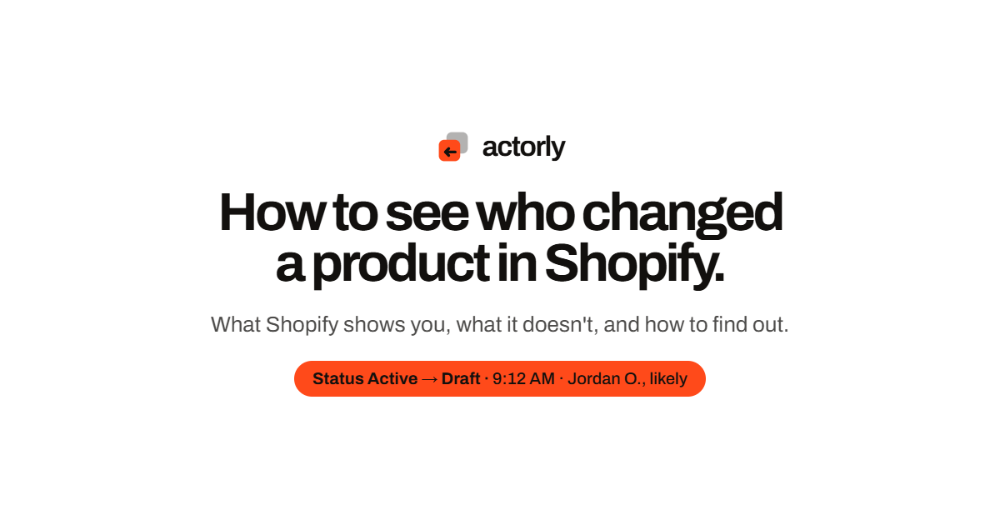

# Actorly design system

Actorly is a Shopify app that keeps a searchable history of the changes in a store: the old value, the new value, when it changed, and, for product changes, who made it when Shopify reports it. It can put select fields back and checks each restore afterwards. It is made by ONDUTYOPS LLC.

This repository is the Actorly design system: the colour, type, layout and motion tokens, the fonts, the logo pack, the React components, page specimens, and the rules for how Actorly looks and sounds. It is the single source of truth for the brand surface. It is also a ready-made [Claude Code](https://claude.com/claude-code) skill: `SKILL.md` sits at the root, so the whole repository can be dropped into a `.claude/skills/actorly-design/` folder and used as it is.




> **Read this before you copy a sentence.** The pages in `ui_kits/` are layout specimens. Their copy is placeholder, written to show spacing, type and motion, and it is not a statement of fact about the product. True copy comes from the product's own facts: its coverage table, its plans and its data and privacy statements. See [`guidelines/copy-and-claims.md`](guidelines/copy-and-claims.md) and [`ui_kits/README.md`](ui_kits/README.md).

## What is in here

```
SKILL.md             the skill entry point (Claude Code reads this first)
README.md            this file: the index and the short rules
NOTICE.md            rights, font licences, third-party marks
CHANGELOG.md         what changed in each version
styles.css           the one file to link: it only @imports the tokens
tokens/              fonts, colors, typography, layout, motion, assets (glyph and mark classes), base
fonts/               Archivo and Inter (variable, Latin) with their SIL OFL licence texts
assets/logos/        svg/, png/, favicon/, and the Brand Assets sheet that shows every variant
assets/og/           share images (1200x630), one per page type
guidelines/          the rules in depth, plus a specimen card per token group
components/          brand, actions, labels, data, cards, content: JSX, .d.ts, .prompt.md and one card per folder
motion/              motion-kit.js and MOTION-BRIEF.md
ui_kits/website/     page specimens (home, coverage, docs, blog, article, changelog, security, contact, legal, 404, OG cards, the site's own design page)
_ds_bundle.js        the built components the specimen cards load (see below)
```

Notes on a few files:

- `_ds_bundle.js` is generated from `components/**/*.jsx` by the design tool and is read by the six `*.card.html` cards under `components/`. Do not edit it by hand; re-export from the design tool. If you do not need the cards you can delete it together with them.
- The `.dc.html` files are "Design Components": self-contained pages with inline styles, opened in a browser with the `support.js` runtime beside them. They load React, ReactDOM and Babel from unpkg.com when opened.
- Seven share images (Home, What it tracks, Docs, Changelog, Contact, Security and DPA) are not in `assets/og/`: their text is withdrawn until it is re-exported from `ui_kits/website/Actorly OG Cards.dc.html` against the product's facts. See `guidelines/pages-and-seo.md`.
- The Shopify glyph is not in this repository (it is Shopify's trademark). Install-button specimens show an empty slot where it goes. See `guidelines/assets.md`.

## How to use it

This repository is published for reading and for use by the Actorly team and its contractors; GitHub's Terms let others view and fork it on GitHub, and no other licence is granted (see `NOTICE.md`).

**1. As a Claude Code skill inside a repository.** Copy or clone this repository into `.claude/skills/actorly-design/` in the project that needs the brand (so that `SKILL.md` is at `.claude/skills/actorly-design/SKILL.md`). Claude Code then uses it on its own for Actorly-branded work, or you can call it by name with `/actorly-design`. It reads this file first, then the tokens, components, logos and layouts it needs.

```bash
git clone https://github.com/oderajoseph95/actorly-design-system .claude/skills/actorly-design
rm -rf .claude/skills/actorly-design/.git
```

**2. As a skill for one machine.** Put it in `~/.claude/skills/actorly-design/` instead. Every project on that machine can then use it.

**3. As plain CSS and assets.** Link one file and you have every token, the fonts and the mark classes:

```html
<link rel="stylesheet" href="styles.css">
```

Then use the variables (`var(--ink)`, `var(--ember)`, `var(--font-sans)`, `var(--ease-settle)`) and the helper classes (`.actorly-mark`, `.tabular`). Copy logos and share images straight from `assets/`.

## The short rules

**Colour.** Ink `#12100E`, paper `#F2EFE9` and white build everything. Ember `#FF4A1A` is the single accent: the logo's front card, change stamps, the active ring, calls to action on ink, text selection. Ember-text `#A32C00` is ember as text on a light ground. Warm stone greys (`#57514A` body, `#6B645B` muted, `#DDD6CA` line); never cool greys outside Shopify admin mock-ups. Status colours (Likely, Unknown, Not yet, Not possible, was, now) appear only on change data. No gradients, textures or illustrations.

**Type.** Archivo for everything, display at weight 700, width 100, tight tracking (-5.8% for H1, -5.5% for H2) and a 0.92 to 0.94 line height, balanced wrapping. Body at weight 400, line height 1.55 to 1.6. Tabular figures for counters, prices and times. No monospace on the brand surface. Inter is for Shopify admin mock-ups only.

**Layout.** A centred two-line headline, then a lede (17 to 20px), then one demo. Section padding about 140px (160 on the home page). Content up to 1240px, demos 1180px, text 860px. Cards are white with a 1px `#DDD6CA` ring instead of a shadow, with 22 to 26px corners. Paper, white and ink sections alternate; two ink sections never touch.

**The logo.** Two versions of one thing: the older one behind at 32% opacity and the current one in front, in ember, with a back arrow. The wordmark is lowercase "actorly" in Archivo 650. Clear space is one third of the mark's width on every side; minimum size 16px. Never rotate it, recolour the front card, stretch it, put it on a busy photo, or set "actorly" in another font or in capitals.

**Voice.** Plain, specific, calm. Talk to the merchant as "you"; call the product "Actorly". Sentence case everywhere, buttons and nav included. Headlines end with a full stop and are broken by hand where the meaning breaks. No eyebrows above headlines. Buttons start with a verb. Numbers over adjectives; example figures are labelled "Example store". No emoji. Nothing negative about Shopify or a competitor.

**Honesty is the brand.** Show "Unknown" rather than guess; Unknown is never upgraded later. A person's or app's name always sits beside how sure Actorly is (Likely, Possible, Unknown, or a waiting state). A correlation is never written as a cause: never "caused", "because of", "resulted in", "led to" or "due to"; say "followed" or "around the same time as". Quote counts from the product's coverage table, never a number you typed. Do not claim a feature that is not built.

**Motion.** Settle, `cubic-bezier(.16,1,.3,1)`, is the house easing. Headlines rise line by line from a mask. Only transform and opacity move; one pinned scroll scene per page; reduced motion shows the finished state.

**The Shopify admin.** The embedded app runs inside Shopify admin and uses Shopify's own Polaris web components, so it looks like Shopify admin, not like the marketing brand. Mock-ups of the app on the marketing surface use the `--admin-*` greys and `--font-admin`, and the only Actorly brand element inside the frame is the mark. Rules that hold in the app regardless of the library: an actor never renders without its confidence; Unknown renders at full strength and never in a critical tone; before and after values carry no semantic colour; "still building", "nothing found" and "filtered to zero" are three different empty states.

## Where the full rules are

| Topic | File |
|---|---|
| Colour, type, layout, radius, depth tables | [`guidelines/design-system.md`](guidelines/design-system.md) |
| Nav, footer, buttons, stamps, rows, cards, forms | [`guidelines/components.md`](guidelines/components.md) |
| What may and may not be claimed, plans, data | [`guidelines/copy-and-claims.md`](guidelines/copy-and-claims.md) |
| Logos, favicons, share images, fonts | [`guidelines/assets.md`](guidelines/assets.md) |
| Page structure, titles, meta, structured data | [`guidelines/pages-and-seo.md`](guidelines/pages-and-seo.md) |
| Motion catalogue and timings | [`guidelines/motion.md`](guidelines/motion.md), [`motion/MOTION-BRIEF.md`](motion/MOTION-BRIEF.md) |
| Component props and usage | [`components/README.md`](components/README.md) |
| What the page specimens are | [`ui_kits/README.md`](ui_kits/README.md) |

## How changes are made

The source of this repository is the export from the Actorly design tool. To change something, change it in the design tool and export again, or open a pull request here with the change and say what it replaces. Do not hand-edit generated files (`_ds_bundle.js`, the exported PNGs under `assets/`). A change to a rule in `guidelines/copy-and-claims.md` must match the product's facts first; copy follows the product, never the other way round.

## Rights

Copyright 2026 ONDUTYOPS LLC. All rights reserved. This is not an open-source licence: the Actorly name, logo and brand assets may not be used to imply endorsement or affiliation. The fonts are under their own SIL Open Font Licence texts, and the Shopify glyph is Shopify's trademark and is not included. Details are in [`NOTICE.md`](NOTICE.md).
